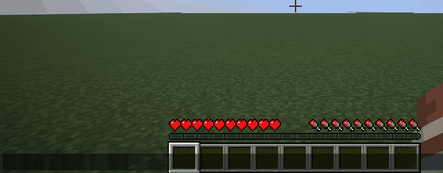
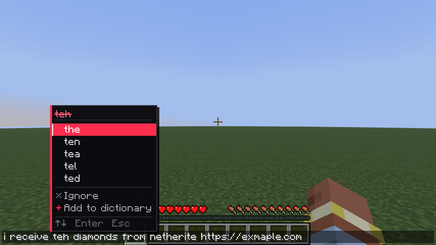
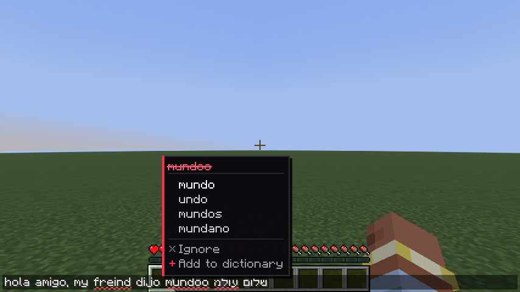
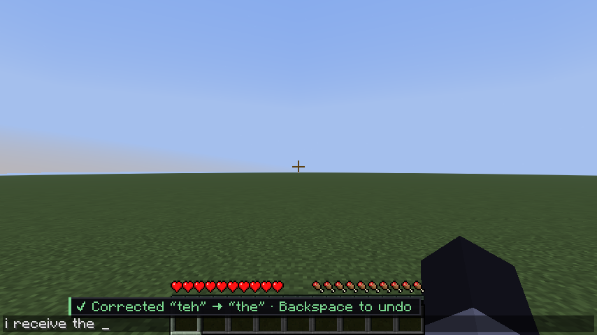
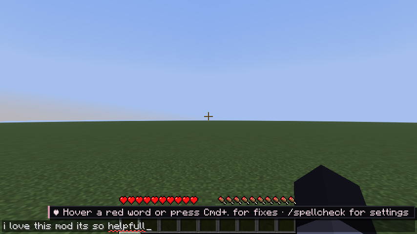
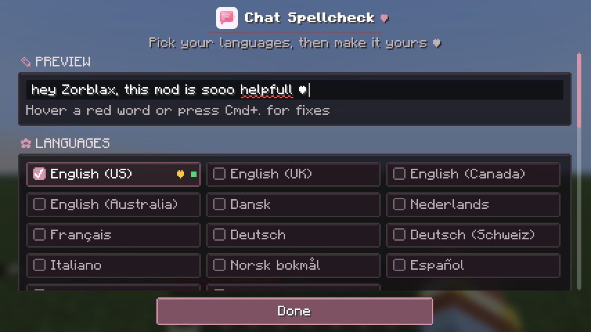
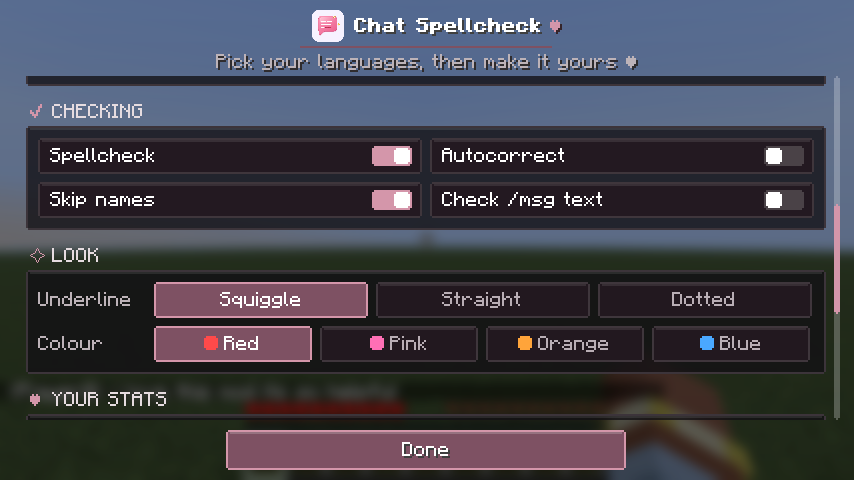
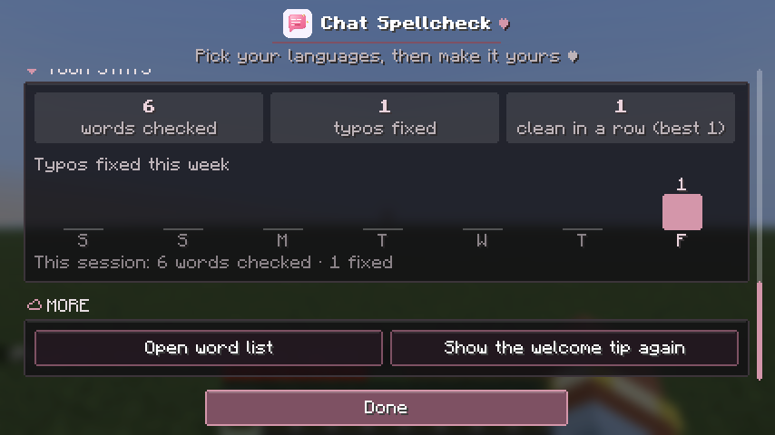
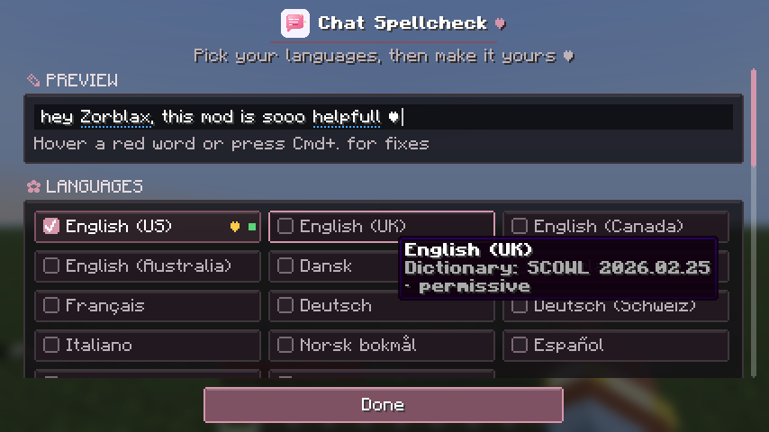
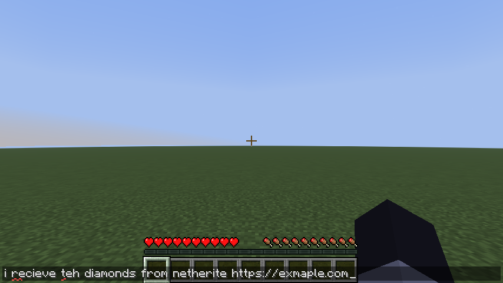

<div align="center">


# 💖 Chat Spellcheck 💖

**A little spellchecker for Minecraft's chat box ♡**

Typos get a red squiggle as you type. Hover one and click to fix it!



Client-side Fabric mod · works on any server · fully offline

[▶️ Watch the 18-second demo on YouTube](https://youtu.be/L_5H6EEQymU)

[Download](https://github.com/BlueDreams666/chat-spellcheck/releases/latest) · [Report a bug](https://github.com/BlueDreams666/chat-spellcheck/issues)

</div>

## 💕 Features

- **Underlines as you type.** Misspelled words get a red squiggle. Nothing else about the chat box changes.
- **Click to fix.** Hover a word to see suggestions, then click one. Only that word changes, and your cursor stays where it was.
- **Keyboard shortcut.** Press **Ctrl+.** (**Cmd+.** on Mac) to open suggestions for the word at your cursor. Use **↑/↓** to pick one, **Enter** to apply it, **Esc** to close.
- **Ignore or add words.** **Ignore** hides a word until you close the game. **Add to dictionary** saves it for good.
- **14 dictionaries.** You can turn on as many as you like, and a word counts as correct if any of them knows it:
  - English (US, UK, Canada, Australia)
  - Danish, Dutch, French, German, Swiss German, Italian, Norwegian (Bokmål), Spanish
  - Hebrew and Arabic
- **Knows Minecraft.** Item, block and mob names (modded ones too), online players' names, and common chat slang like `gg`, `afk` and `brb` are never flagged.
- **Knows chat.** Stretched words like `sooo` and `yesss`, and laughs like `hahaha`, `xddd` and `חחח`, are left alone. So are capitalised names in the middle of a sentence ("ask Zorblax").
- **Smart suggestions.** The most likely word comes first, using word frequencies for English, German, Spanish, French, Italian and Hebrew.
- **Ready on first launch.** The mod turns on the dictionary for your game's language, and a little tip shows you how it works the first few times you open chat.
- **A cosy settings screen.** It has a live preview, your choice of underline style and colour (including blue for colour-blind players), and stats for your typing.
- **Optional autocorrect.** Off by default. When it's on, only typos it's very sure about are fixed (see [Autocorrect](#-autocorrect)).

## 📸 Screenshots

| | |
|---|---|
|  |  |
| **Ctrl+.** picks a fix from the keyboard | Several languages in one message |
|  |  |
| Optional autocorrect, Backspace undoes it | A welcome tip for your first chats |
|  |  |
| `/spellcheck` settings with a live preview | Switches, plus underline style and colour |
|  |  |
| Your stats, kept on your computer | The preview updates as you choose |

## 🌸 Install

1. Install [Fabric Loader](https://fabricmc.net/use/installer/) 0.19.5 or newer.
2. Download the JAR that matches your Minecraft version, then put it and [Fabric API](https://modrinth.com/mod/fabric-api) in your `.minecraft/mods` folder.
3. Start the game and open chat.

| Minecraft | Mod JAR | Fabric API |
|---|---|---|
| 26.3 | `chat-spellcheck-2.0.0+26.3.jar` | 0.162.0+26.3 |
| 26.2 | `chat-spellcheck-2.0.0+26.2.jar` | 0.161.0+26.2 |

The JAR is about 19 MB because it includes every dictionary, but only the languages you turn on are loaded into memory.

## ⚙️ Settings

Type `/spellcheck` in chat to open the settings screen. If you have [Mod Menu](https://modrinth.com/mod/modmenu), you can also open it from the mod list. The screen has these sections:

- **Preview** shows a pretend chat line that changes as you change settings.
- **Languages** is where you pick dictionaries. A gold ♥ marks your game's language, and a dot shows whether each dictionary is loaded.
- **Checking** has switches for spellcheck, autocorrect, skipping names, and checking `/msg` text.
- **Look** sets the underline style (squiggle, straight or dotted) and colour (red, pink, orange or blue).
- **Your stats** shows words checked, typos fixed, your streak of messages sent without a typo, and fixes per day this week.
- **More** opens your word list or brings back the welcome tip.

Changes apply when you press **Done**. The screen scrolls if it doesn't fit.

You can also use commands:

| Command | What it does |
|---|---|
| `/spellcheck status` | Shows what's turned on |
| `/spellcheck on` / `off` | Turns checking on or off |
| `/spellcheck language en_US,es_ES` | Sets your languages |
| `/spellcheck add de_DE` / `remove de_DE` | Adds or removes one language |
| `/spellcheck autocorrect on` / `off` | Turns autocorrect on or off |
| `/spellcheck commands on` / `off` | Also checks the text of `/msg`, `/tell`, `/w`, `/r`, `/me`, `/say`, `/teammsg` |
| `/spellcheck forget <word>` | Removes a word you added |

Language codes: `en_US en_GB en_CA en_AU da_DK nl_NL fr_FR de_DE de_CH it_IT nb_NO es_ES he_IL ar`. Short forms like `de`, `es` or `he` work too.

Your settings, saved words and stats are in `.minecraft/config/chatspellcheck/`. The word list, `custom-words.txt`, is a plain text file with one word per line, so you can edit it by hand. Stats are in `stats.properties`. They never leave your computer, and you can delete the file to reset them.

<p align="center"></p>

## 🙈 What doesn't get checked

To avoid nagging you about things that aren't typos, the mod skips:

- slash commands (unless you turn on `/spellcheck commands`)
- links, email addresses and file names
- @mentions, #tags, `:emoji:` codes and colour codes
- anything with a number in it, like coordinates or `1st`
- single letters, ALL-CAPS words, and mixed-case words like `iPhone`
- words in a language you don't have turned on
- stretched words like `sooo` or `yesss` (when the shorter word is a real word)
- laughs like `hahaha`, `jajaja`, `xddd` or `חחח`
- capitalised words in the middle of a sentence, which are usually names. The first word of a sentence is still checked. You can turn this off with **Skip names**. It's never used with German, because German capitalises every noun.

Lowercase names like "london" are accepted too.

## ✨ Autocorrect

Autocorrect is off until you turn it on. When it's on, it only fixes a word after you finish it, and only when the right fix is clear. If it gets one wrong, press **Backspace** straight away to undo it, and it won't change that word again until you restart the game. Capitalised words are only fixed at the start of a sentence, so names are left alone.

How much it fixes depends on the language:

| Language | What autocorrect fixes |
|---|---|
| English | Most clear one-letter typos ("teh" → "the") |
| Spanish, French, German, Italian, Dutch, Norwegian | Missing accents only ("cancion" → "canción", "uber" → "über") |
| Hebrew | Final letter forms ("שלומ" → "שלום") and clear one-letter typos in longer words |
| Swiss German, Danish, Arabic | Nothing. Typos are still underlined with suggestions. |

## 💭 Good to know

- It checks spelling one word at a time. It can't catch real words used in the wrong place ("their" vs "there"), and it doesn't check grammar.
- Hebrew and Arabic show in the right reading order while you type, with Arabic letters joined. Only the display changes; your message is sent exactly as you typed it.
- It only works in the chat box, not on signs, books or anvils.

## 🛠️ For developers

You'll need JDK 25.

```bash
./gradlew build
```

The JAR ends up in `build/libs/`. The default build targets Minecraft 26.3. To build for 26.2:

```bash
./gradlew build -Pminecraft_version=26.2 -Pfabric_api_version=0.161.0+26.2
```

There's a separate JAR per version because 26.2 uses GLFW for input and 26.3 uses SDL3, which number keys differently.

### Tests

- `./gradlew test` runs the unit tests: suggestion ranking, autocorrect accuracy, text scanning, background threading, and handling of broken or hand-edited config files.
- `./gradlew runClientGameTest` starts the real game, creates a world and drives the chat box. It covers the welcome tip, stats, underlines, the suggestion popover, keyboard controls, the settings screen at several window sizes and GUI scales, right-to-left text and autocorrect. It also measures how long the overlay takes to draw. Screenshots go to `build/run/clientGameTest/screenshots/`.

### How it works

- Spelling uses [Apache Lucene's Hunspell](https://lucene.apache.org/) implementation, written in pure Java, with the same dictionaries as LibreOffice.
- Hunspell finds good candidates but doesn't know which words are common, so the mod re-ranks them. It weighs typo distance (neighbouring keys, swapped or doubled letters), word frequency, and a small boost for Minecraft words.
  - On the English test lists, this puts the right word first noticeably more often than Hunspell's own order: 45 vs 37 out of 49 on the final list.
  - Frequency lists for German, Spanish, French, Italian and Hebrew are new in 2.0. On a fixed set of 400 typos (80 per language), the right word comes first 318 times, up from 279 without them.
  - Each list is loaded only while its language is turned on.
- Checking, suggestions and dictionary loading each run on their own background thread, so the game never waits on them. Results are matched to the exact text they were made for, so a slow result can't underline or replace the wrong word.

The code is organised like this:

| Package | What's in it |
|---|---|
| `core` | Spellchecking, ranking, autocorrect and settings. No Minecraft code. |
| `ui` | Popover layout and state, right-to-left text layout |
| `client` | The chat overlay, welcome tip, settings screen and `/spellcheck` command |
| `mixin` | Hooks into Minecraft's chat screen and text box |

## 📜 License

The mod's code is [MIT](LICENSE). The bundled dictionaries and libraries have their own licences:

- Apache Lucene: Apache-2.0
- English dictionaries (SCOWL): permissive
- Word frequency lists: MIT / CC BY 3.0
- German, Swiss German, Italian: GPL
- Hebrew: AGPL-3.0
- Danish, Spanish, Arabic: GPL, LGPL or MPL (your choice)
- French: MPL-2.0
- Dutch: BSD or CC BY
- Norwegian: CC BY 4.0

If you redistribute the JAR, follow those licences. You can find the full details in [THIRD_PARTY_NOTICES.md](THIRD_PARTY_NOTICES.md).

<div align="center">

Made with 💗 for everyone who types too fast in chat

</div>
